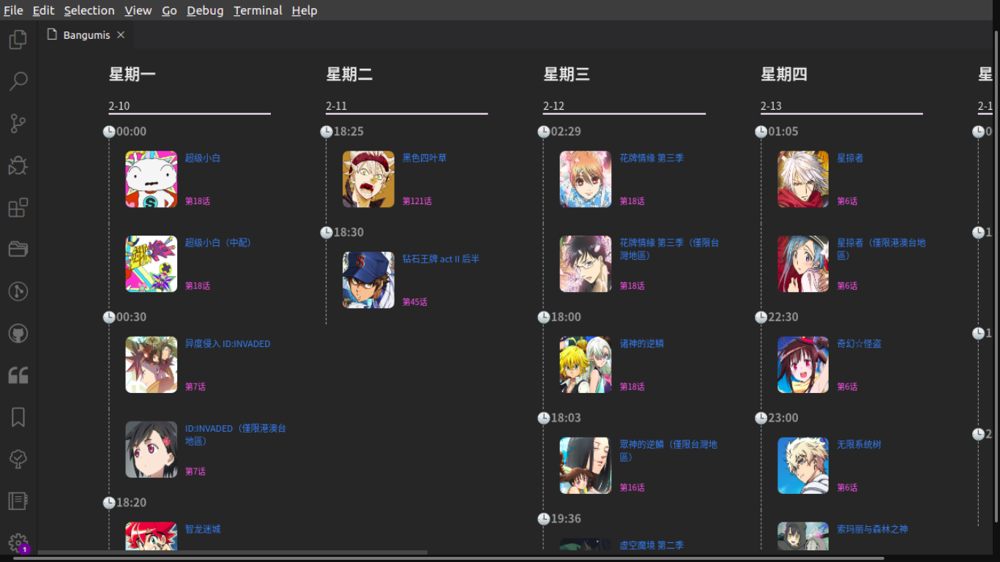

# Bangumi Open

[](https://marketplace.visualstudio.com/items?itemName=SDTTTTT.bangumiopen)

> 一款基于 **Vscode** 的番剧插件, 数据来自 B 站.

## Features

提供的`番剧索引`. 以及`新番时间表` 的功能.



### Reminder

> 该功能在配置文件中可以被关闭.

**BangumiOpen**会在下面的状态栏处显示下一部即将更新的番剧 _（该状态栏可被关闭）_.
插件有自带提醒的功能. 在番剧更新时会以提示窗的形式提醒你.
如果你喜欢在评论区里快人一步, **BangumiOpen**也提供了能**提前**提醒时间的配置选项`ReminderAheadTime`.

## Quick Usage

`Ctrl+Shift+P` 调出命令栏后,输入`Open Bangumi`或 `Bangumi Open: Week Bangumi` 即可打开视图.

使用 `Bangumi Open: Index` 可打开索引. 选中索引后自动触发`Open Bangumi`命令.

> 在一级索引中选中`(恢复默认)`可清除所有已经选中的 Tag.

`Next Page` 和 `Back Page` 提供翻页功能.

`Next Page` 可用 `Ctrl+alt+l` 代替

`Back Page` 可用 `Ctrl+alt+k` 代替

## Configuration

```json
"bangumiOpen.DisplayHistory": false,  // 是否显示前六天的番剧更新
"bangumiOpen.EnableReminder": true,   // 是否开启番更新剧提醒
"bangumiOpen.ReminderAheadTime": 0,   // 更新提醒时间提前 (单位：秒)
"bangumiOpen.DisplayIndexTags": true, // 使用索引时是否显示已经选中的Tag
"bangumiOpen.DisplayStatusBar": true  // 是否显示状态栏提示
```

## Contribution


